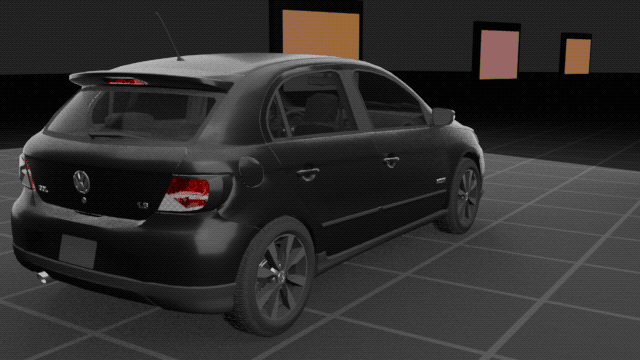

# Rodrigo Schmitt de Almeida — Portfólio 3D (VW Gol G5)

Portfólio interativo em **Three.js**, **TypeScript** e **Blender 5.1**, no qual você conduz um **Volkswagen Gol G5 Preto** por um circuito de 7 estações exibindo projetos reais de sistemas embarcados, FinTech/AppSec, investigação em grafos, saúde com IA e ciência de dados.

**Demo online:** [rodrigoschmittdealmeida.github.io](https://rodrigoschmittdealmeida.github.io/)



---

## Projetos no Circuito

Cada estação no ambiente 3D exibe lado a lado uma demonstração animada em tela (que executa somente quando está no campo de visão da câmera) e um painel editorial com arquitetura e métricas reais.

| # | Projeto | Área | Resumo | Repositório |
|---|---------|------|--------|-------------|
| 1 | **leitorECU** | Sistemas Embarcados & Telemetria | Scanner e datalogger multiplataforma (Desktop 30 FPS + App Mobile/Tablet Flutter) com osciloscópio triplo, Mapa 2D, Replay CSV/.msl e suporte a CAN UDS, KWP2000, KW1281 e OBD-II. | [RodrigoSchmittDeAlmeida/leitorECU](https://github.com/RodrigoSchmittDeAlmeida/leitorECU) |
| 2 | **V-Stable** | FinTech B2B & AppSec | Plataforma cross-border de câmbio e stablecoins em Java 25 / Spring Boot 4.1.1, React 19, PostgreSQL 16 (Flyway V1–V20), sanitizador Rust (`zero-unsafe`) e 37/37 testes STRIDE. | [RodrigoSchmittDeAlmeida/v-stable-frontend](https://github.com/RodrigoSchmittDeAlmeida/v-stable-frontend) · [backend](https://github.com/RodrigoSchmittDeAlmeida/v-stable-backend) |
| 3 | **V-Stable Chatbot IA** | IA Aplicada & UX | Assistente virtual (`SupportChatWidget.tsx`) com fallback determinístico Zero-PII, heurísticas de Nielsen e rate-limit de 15 req/min com cooldown regressivo. Inclui simulador interativo no modal. | [RodrigoSchmittDeAlmeida/v-stable-frontend](https://github.com/RodrigoSchmittDeAlmeida/v-stable-frontend) |
| 4 | **Vincula** | Investigação Digital & Grafos | Plataforma AGES/PUCRS em Next.js 15.4 + React 19.1 com grafo `@neo4j-nvl/react` para cruzamento de quebras de sigilo SIMBA, SITTEL, RIF e extratos CNAB/CSV/XLSX. | [tools.ages.pucrs.br/vincula/frontend](https://tools.ages.pucrs.br/vincula/frontend) |
| 5 | **OrdoVitae** | HealthTech & IA Clínica | Motor híbrido (FastAPI + DeepSeek-V3 + regras SWALIS) da 9ª Hackatona PUCRS / HSL para priorização cirúrgica no SUS com validação literal e 0% de alucinação (941 pacientes). | [Hacktona-AGES-2026/OrdoVitae](https://github.com/Hacktona-AGES-2026/OrdoVitae) |
| 6 | **T2IA — Rede Neural & AG** | IA & Computação Evolutiva | MLP 9-18-9 em Python puro treinada sem backpropagation via Algoritmo Genético (`BLX-α`, elitismo, currículo Médio→Difícil) contra Minimax, com UI Tkinter e mapa de calor `tanh`. | [RodrigoSchmittDeAlmeida/T2IA](https://github.com/RodrigoSchmittDeAlmeida/T2IA) |
| 7 | **Smart Talent** | Ciência de Dados & ML | Torre de decisão logística sobre 180.519 registros DataCo Supply Chain com Random Forest (`83,22%` precisão na classe 1), API FastAPI, Docker e dashboard analítico. | [RodrigoSchmittDeAlmeida/Grupo8-Smart-Talent](https://github.com/RodrigoSchmittDeAlmeida/Grupo8-Smart-Talent) |

---

## Controles

### Direção & Câmera
| Tecla / Ação | Função |
|---|---|
| `W` `A` `S` `D` ou Setas | Acelerar, frear/ré e esterçar |
| `Espaço` | Freio de mão / Drift (com fumaça nos pneus traseiros) |
| `Shift` | Modo esportivo / aceleração extra |
| `C` | Alternar câmera (`Perseguição` / `Orbital`) |
| `H` ou `L` | Ligar/desligar faróis |
| `B` | Buzina |
| `R` | Resetar posição do carro para a largada |

### Piloto Automático, Tour & Inspeção
| Tecla / Ação | Função |
|---|---|
| `1` – `7` (ou clique na barra superior / minimapa) | Piloto automático (Pure Pursuit com desvio de obstáculos) até a estação selecionada |
| `T` (ou botão **Tour Auto**) | Percorre automaticamente as 7 estações com pausa de 9s em cada tela (pressionar `WASD`/Setas retoma o controle manual) |
| `E` / `Enter` ou clique na tela 3D | Abre a ficha técnica completa do projeto (e o simulador interativo na estação **Chatbot IA**) |
| `Esc` | Fecha o modal aberto |

---

## Arquitetura & Stack

- **Renderização 3D:** Three.js (`SceneManager.ts`, iluminação difusa de estúdio via PMREM, sombra de contato, faróis `SpotLight`, partículas de fumaça e síntese sonora procedural em Web Audio API).
- **Física & Piloto Autônomo:** `CarController.ts` com modelo Ackermann simplificado, suspensão/rolagem, pivôs reais de rodas e volante, algoritmo Pure Pursuit em 2 estágios (`entry` → `park`) e desvio repulsivo de obstáculos.
- **Telas & Gaze Gating:** `ProjectMonuments3D.ts` + `ScreenDemoRenderer.ts` renderizam vídeo-demos em `<canvas>` 2D atualizados a ~20 FPS apenas quando a estação está dentro do frustum e do ângulo de visão (`< 46 m`).
- **Asset 3D (`blender/process_gol_g5.py`):** Pipeline reprodutível no Blender 5.1.1 que exporta `public/models/gol_g5.glb` (~3,95 MB, ~109.9k polígonos) com pintura VW Preto Ninja calibrada para PBR.

---

## Executando Localmente

```bash
npm install
npm run dev
```

Build de produção (com verificação TypeScript):

```bash
npm run build
npm run preview
```

---

**Autor:** Rodrigo Schmitt de Almeida — Engenharia de Software (PUCRS)
